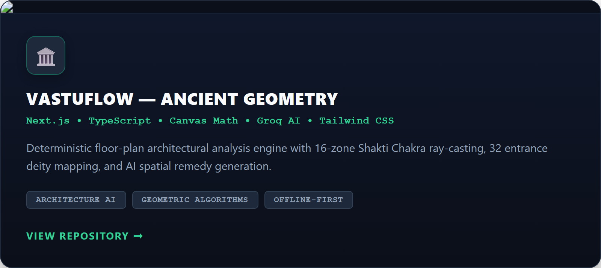
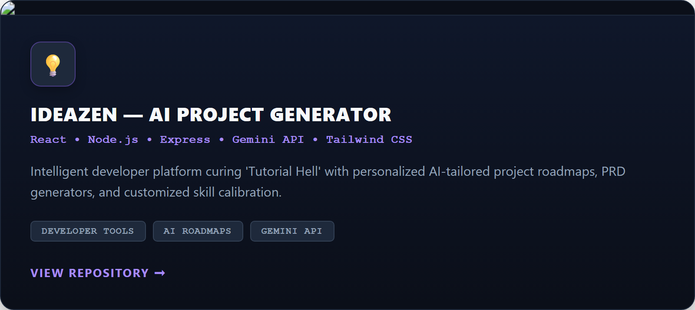
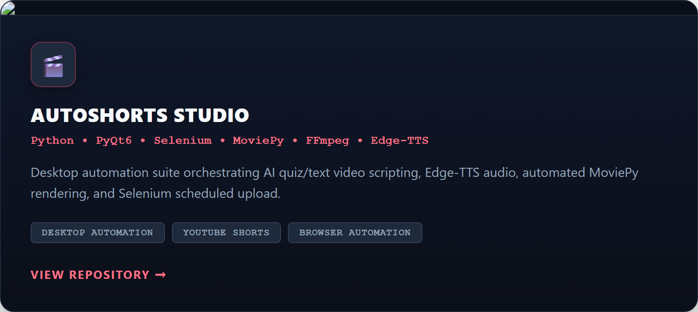
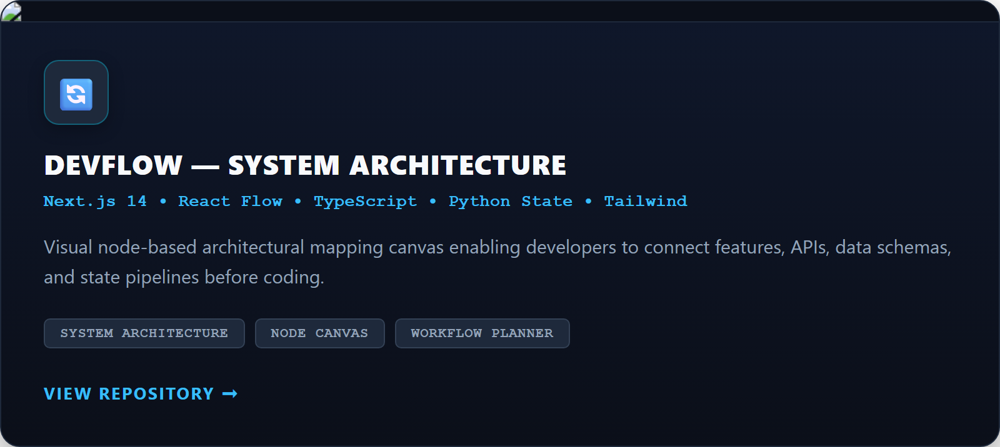

<a href="mailto:nirmitangane@gmail.com">
  <picture>
    <source media="(prefers-color-scheme: dark)" srcset="./header-dark.svg">
    <source media="(prefers-color-scheme: light)" srcset="./header.svg">
    
  </picture>
</a>

<header>
  

    
    
    
  

</header>

   
  
  
  

 

<h2 align="center">🙋‍♂️ About Me</h2>

  

 

<h2 align="center">🛠️ Technology Stack & Workflow Architecture</h2>

  

 

<h2 align="center"> 📊 My GitHub Stats  </h2>

  <table width="100%">
    <tr>
      <td width="52%" align="center">
        
      </td>
      <td width="48%" align="center">
        
      </td>
    </tr>
  </table>

 

<h2 align="center">📈 Contribution Stats</h2>

  

  <table width="100%">
    <tr>
      <td width="50%" align="center">
        
      </td>
      <td width="50%" align="center">
        
      </td>
    </tr>
  </table>

 

<h2 align="center">🎯 Featured Projects</h2>

  <table width="100%">
    <tr>
      <td width="50%" align="center">
        
      </td>
      <td width="50%" align="center">
        
      </td>
    </tr>
    <tr>
      <td width="50%" align="center">
        
      </td>
      <td width="50%" align="center">
        
      </td>
    </tr>
  </table>

 

<h2 align="center">📡 Contact &amp; Status</h2>

  <a href="mailto:nirmitangane@gmail.com">
    <picture>
      <source media="(prefers-color-scheme: dark)" srcset="./contact-dark.svg">
      <source media="(prefers-color-scheme: light)" srcset="./contact.svg">
      
    </picture>
  </a>

 

<h2 align="center">💭 Random Dev Quote</h2>

  <picture>
    <source media="(prefers-color-scheme: dark)" srcset="./quote-dark.svg">
    <source media="(prefers-color-scheme: light)" srcset="./quote.svg">
    
  </picture>

 

<picture>
  <source media="(prefers-color-scheme: dark)" srcset="./footer-dark.svg">
  <source media="(prefers-color-scheme: light)" srcset="./footer.svg">
  
</picture>
