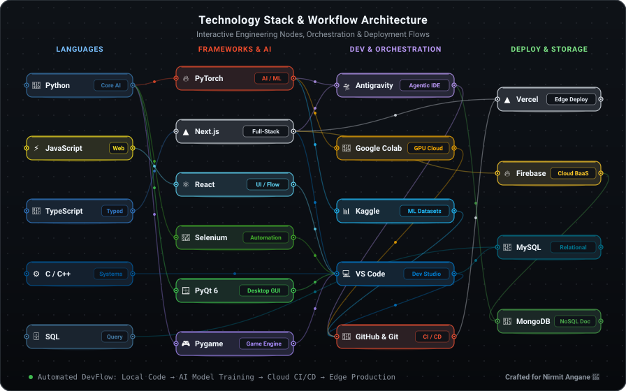

<a href="mailto:nirmitangane@gmail.com">
  <picture>
    <source media="(prefers-color-scheme: dark)" srcset="./header-dark.svg">
    <source media="(prefers-color-scheme: light)" srcset="./header.svg">
    
  </picture>
</a>

<header>
  <div align="center">
    <a href="https://www.linkedin.com/in/nirmit-angane-445201360/">
      
    </a>
    <a href="https://github.com/Nirmit-Angane">
      
    </a>
    <a href="mailto:nirmitangane@gmail.com">
      
    </a>
  </div>
</header>

<div align="center">
  <br />
  
  
  
</div>

<br />

## 🙋‍♂️ About Me

<div align="center">
  
</div>

<br />

## 🛠️ Technology Stack & Workflow Architecture

<div align="center">
  
</div>

<br />

## 📊 My GitHub Stats 

<div align="center">
  
<table>
  <tr>
    <td colspan="2" align="center">
      
      
    </td>
  </tr>
  <tr>
    <td colspan="2" align="center">
      
    </td>
  </tr>
  <tr>
    <td align="center" width="50%">
      
    </td>
    <td align="center" width="50%">
      
    </td>
  </tr>
</table>

</div>

## 📈 Contribution Stats

<div align="center">
  
</div>

<div align="center">
  <table>
    <tr>
      <td>
        
      </td>
      <td>
        
      </td>
    </tr>
  </table>
</div>

## 🎯 Featured Projects

<div align="center">

<a href="https://github.com/Nirmit-Angane/FillTheScreen">
  
</a>
<a href="https://github.com/Nirmit-Angane/pygame-plane-crash">
  
</a>

<a href="https://github.com/Nirmit-Angane/ArcadeDesk">
  
</a>
<a href="https://github.com/Nirmit-Angane/BaseXconvertor">
  
</a>

</div>

## 🌐 Connect With Me

<div align="center">

<a href="mailto:nirmitangane@gmail.com">
  
</a>
<a href="https://www.linkedin.com/in/nirmit-angane-445201360/">
  
</a>
<a href="https://github.com/Nirmit-Angane">
  
</a>

</div>

## 💭 Random Dev Quote

<div align="center">


</div>

### ✨ Fun Fact

```python
class Developer:
    def __init__(self):
        self.name = "Nirmit Angane"
        self.role = "Aspiring Software Developer"
        self.language_spoken = ["hi_IN", "en_US"]
        self.code = ["Python", "Java", "JavaScript", "C"]
        self.tools = ["Next.js", "JQuery", "Git", "VS Code"]
    
    def say_hi(self):
        print("Thanks for dropping by! Let's connect and build something amazing together!")

me = Developer()
me.say_hi()
```

</div>


<div align="center">
  
### ⭐ Show some love by starring some of the repositories!

**Made with ❤️ by Nirmit Angane**

</div>